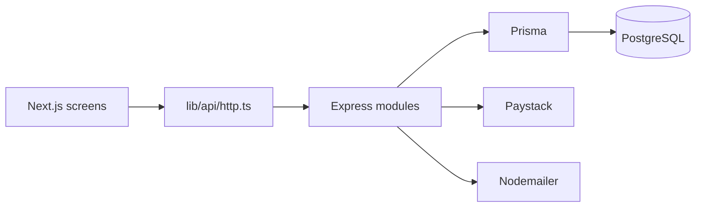

# System architecture

The API is one Express process. Route ownership lives in `src/services` and `src/routes`: auth, appointments, payments, encounters, and operations. They share Prisma, the audit helper, and the error envelope. A service can be split out later because it talks to other areas through Prisma models and HTTP, not through another service's private helpers.

`GET /api/session/workspace` uses the same visibility rules as the list routes and returns one `AppState` snapshot. The browser keeps that snapshot in memory. Mutations call one endpoint and then reload the snapshot.

PostgreSQL holds users, clinical records, documents, and the desk ledger. Clinical encounters, allergies, medication administrations, and payments are not deleted. Staff, departments, and inventory use `deletedAt` when a record must leave active lists.

Jobs use BullMQ only when `REDIS_URL` is present. Otherwise the in-process queue runs the same job names. SMS, Azure Blob, and an external log platform are interfaces with no live calls. Video tokens are HMAC values. The browser camera preview stays in the frontend.
